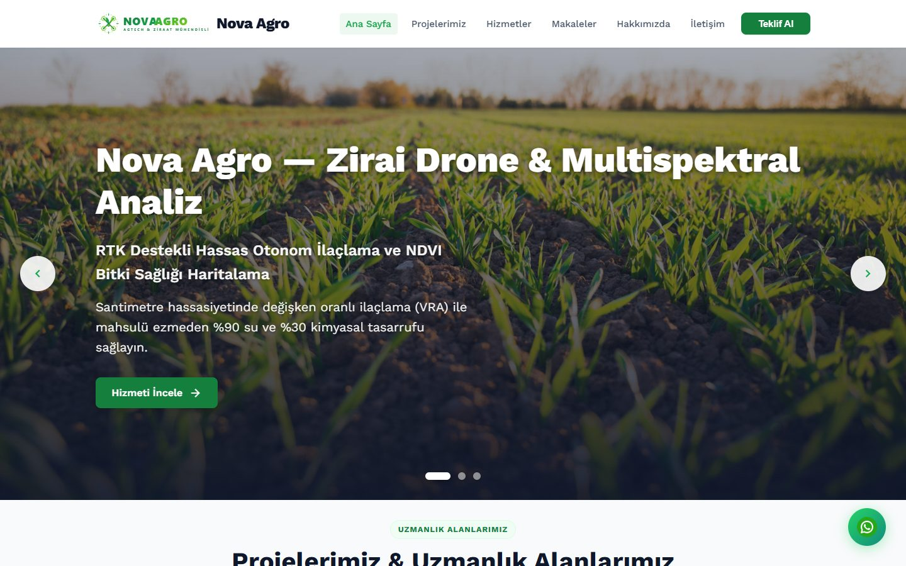
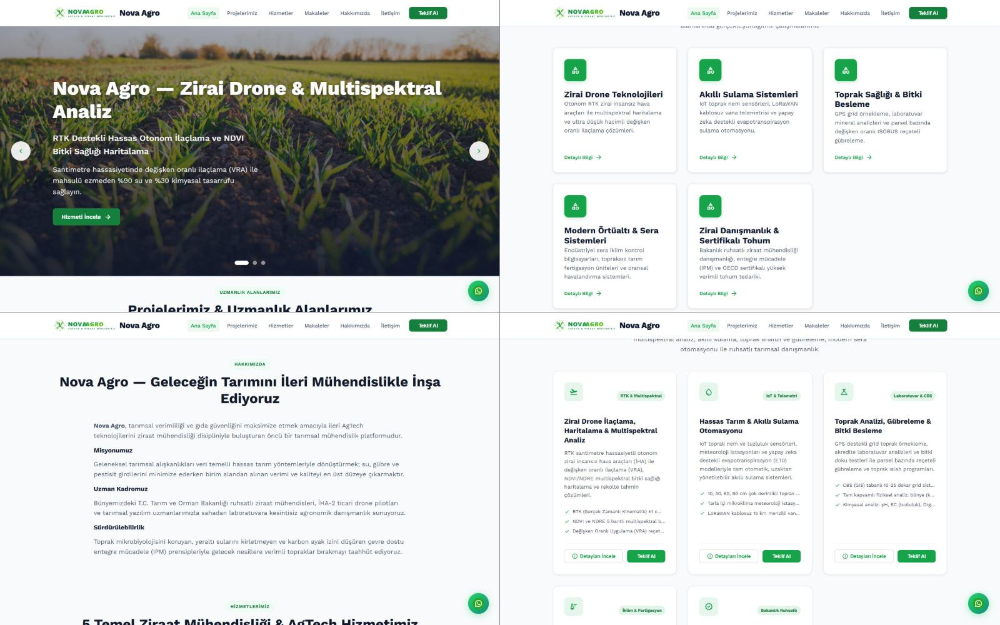
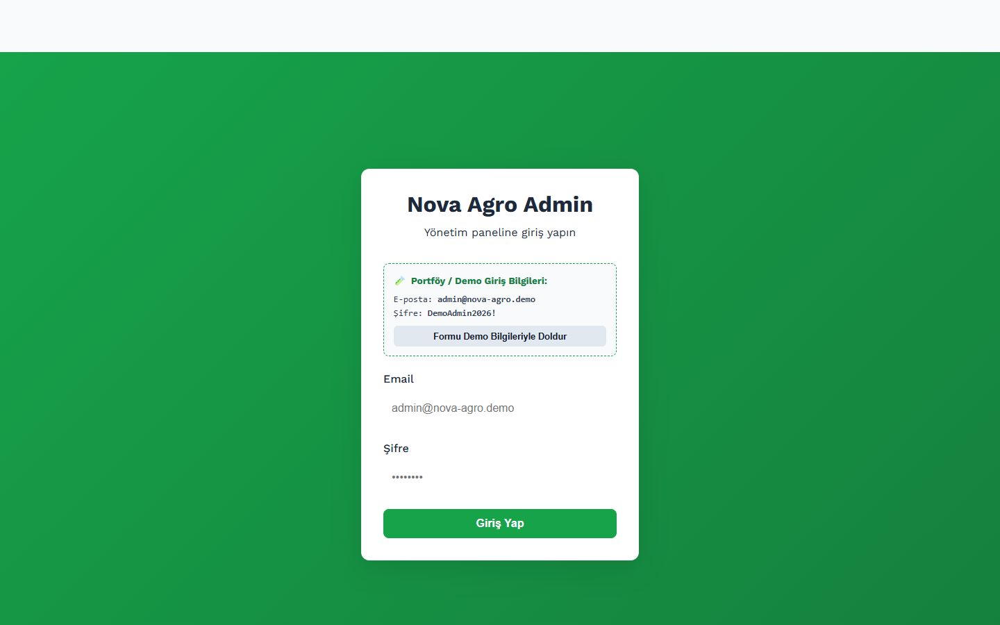
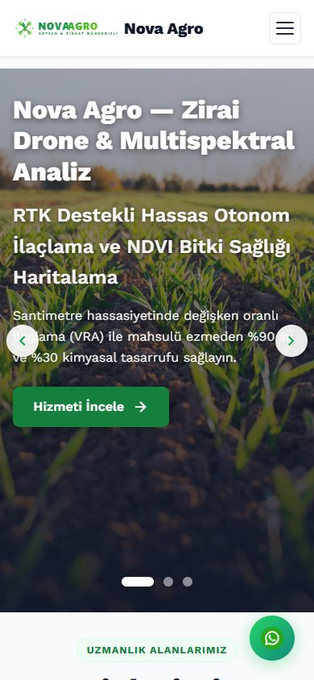
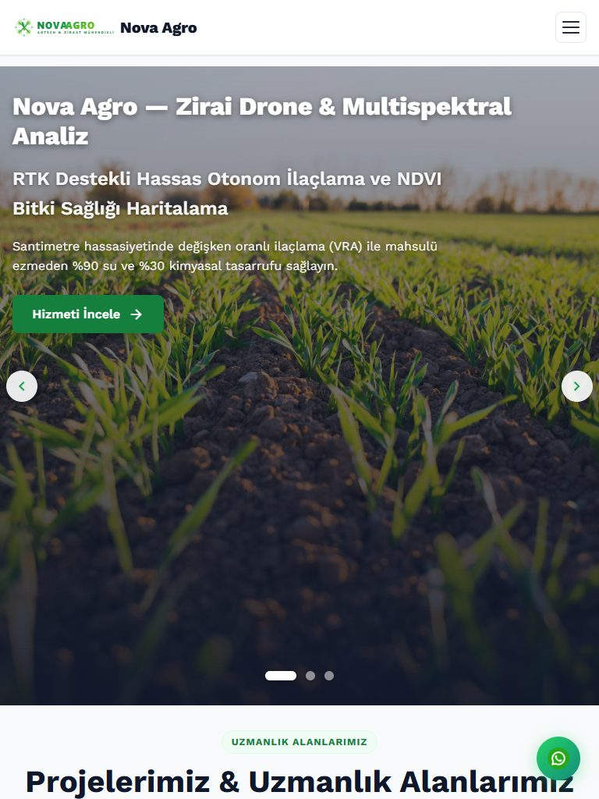

# 🌱 NOVA AGRO — İleri AgTech & Ziraat Mühendisliği Web Portalı

[-15803d?style=for-the-badge&logo=checkmarx&logoColor=white)](#-kapsamlı-e2e-test-ve-kalite-güvencesi)
[](https://react.dev/)
[](https://www.typescriptlang.org/)
[](https://vitejs.dev/)
[](https://nodejs.org/)
[](https://expressjs.com/)
[](https://orm.drizzle.team/)
[](https://www.mysql.com/)
[](docker-compose.yml)

> **Geleceğin Tarımı İçin İleri AgTech & Ziraat Mühendisliği Çözümleri**  
> RTK destekli zirai drone ilaçlama, multispektral NDVI bitki sağlığı haritalama, akıllı sulama otomasyonu, değişken oranlı gübreleme (VRA) ve modern sera iklim kontrol sistemlerini kurumsal bir mimaride buluşturan tam donanımlı web platformu ve yönetim kokpiti.

---

## 📸 Ekran Görüntüleri & Görsel Vitrin (Visual Showcase)

### 🌾 1. Masaüstü Ana Sayfa & Hero Bölümü (Vitrin)
*Sinematik görsel derinlik, sadeleştirilmiş editoryal tipografi ve yüksek kontrastlı eylem çağrısı (CTA).*


---

### 🚜 2. AgTech Hizmetleri & Uzmanlık Projeleri
*Aşırı yapay zeka klişelerinden (neon gölgeler, yapay gradyanlar) arındırılmış, mimari 60-30-10 renk dengesi ve net kart ritmi.*


---

### 🎛️ 3. Nova Agro Kokpit (Yönetim Paneli Dashboard)
*Teknoloji markasına özel `/kokpit` rotası, canlı içerik istatistikleri, makale, hizmet, proje ve teklif yönetimi.*


---

### 🧪 4. Tek Tıkla Demo Giriş Ekranı (Admin & Kokpit)
*Backend veya MySQL kapalı olsa bile çalışan akıllı mock fallback katmanı ve tek tıkla otomatik form doldurma.*


---

### 📱 5. Kusursuz Mobil & Tablet Uyumluluğu (Responsive Design)
*Mobil çekmece menü, dokunmatik uyumlu modal kontrolleri ve taşma yapmayan esnek ızgara düzeni.*

<div align="center">
  
  &nbsp;&nbsp;&nbsp;&nbsp;
  
</div>

---

## ⚡ Hızlı Başlangıç (Quick Start)

Platformu **3 farklı modda** saniyeler içinde çalıştırabilirsiniz:

### Seçenek A: 🐳 Docker Compose ile Tek Komutta Başlatma (Full Stack)
Sisteminizde Docker yüklüyse veritabanı, backend ve frontend servislerini tek bir komutla başlatabilirsiniz:

```bash
docker compose up --build -d
```

#### 🌐 Erişim Noktaları
| Servis | URL | Açıklama |
|---|---|---|
| **Frontend Web Sitesi** | [http://localhost:8080](http://localhost:8080) | Nginx SPA + API Reverse Proxy |
| **Marka Kokpiti (Admin)** | [http://localhost:8080/kokpit](http://localhost:8080/kokpit) | `/kokpit`, `/agro-kokpit` ve `/admin` rotaları |
| **Backend REST API** | [http://localhost:3000](http://localhost:3000) (veya `/api/v1/*`) | Express 5 TypeScript API |
| **MySQL Veritabanı** | `localhost:3306` | UTF-8mb4 destekli MySQL 8 |

---

### Seçenek B: 🧪 Bağımsız Önizleme Modu (Standalone Mock — Sıfır Bağımlılık)
Veritabanı veya Docker gerektirmeden, platformun tüm frontend yeteneklerini (teklif alma modalı, filtreleme, mock kokpit girişi) test etmek için:

```bash
cd frontend
npm install
npm run build
npm run preview
# Tarayıcınızda açın: http://localhost:8080
```

### 🔑 Demo Giriş Bilgileri (Kokpit & Admin)
* **E-posta:** `admin@nova-agro.demo`
* **Şifre:** `DemoAdmin2026!`
* *(Giriş sayfasındaki **"Formu Demo Bilgileriyle Doldur"** butonu tek tıkla oturum açmanızı sağlar.)*

---

## 🏗️ Mimari & Teknoloji Yığını (Tech Stack)

```
                            ┌───────────────────────────────────────┐
                            │      NOVA AGRO CLIENT (REACT 18)      │
                            │   Vite · TypeScript · i18n · React    │
                            └───────────────────┬───────────────────┘
                                                │
                     ┌──────────────────────────┴──────────────────────────┐
                     │                                                     │
         [Offline / Mock Modu]                                   [Canlı API Modu]
                     │                                                     │
        ┌────────────▼────────────┐                            ┌───────────▼───────────┐
        │ Standalone Mock Engine  │                            │  Express 5 REST API   │
        │ mockData.ts (AgTech DB) │                            │  (Node.js 22 LTS)     │
        └─────────────────────────┘                            └───────────┬───────────┘
                                                                           │
                                                               ┌───────────▼───────────┐
                                                               │  Drizzle ORM Migrator │
                                                               └───────────┬───────────┘
                                                                           │
                                                               ┌───────────▼───────────┐
                                                               │    MySQL 8 Database   │
                                                               └───────────────────────┘
```

### 🎨 Frontend Yetenekleri
- **Framework & Araçlar:** React 18, TypeScript 5, Vite 5, React Router v6, i18next (TR/EN).
- **Anti-Slop Tasarım Sistemi (`design-taste-frontend`):**
  - **60-30-10 Kuralı:** %60 nötr mimari slate (`#f8fafc`, `#ffffff`), %30 yapısal kurumsal koyu gri (`#0f172a`, `#334155`), %10 botanik AgTech yeşili (`#15803d`).
  - Radyoaktif yeşil gölgeler ve yapay gradyanlar elenmiş, mimari gölge derinliği kazandırılmıştır.
- **Güvenlik (Sanitization):** `DOMPurify` entegrasyonu ile zengin metin alanlarında XSS koruması.
- **Görsel Varlıklar:** DJI, John Deere, Trimble, Netafim, Yara ve Rain Bird için temiz, optimize edilmiş monokrom vektörel SVG logoları.

### ⚙️ Backend & Veri Katmanı
- **API Mimarisi:** Express 5 + TypeScript + ESM.
- **ORM & Veritabanı:** Drizzle ORM + MySQL 8 (Type-safe schema, otomatik migration ve seed mekanizması).
- **Kimlik Doğrulama:** JWT (JSON Web Tokens) + Bcrypt parola şifreleme.
- **Güvenlik Standartları:** Helmet HTTP başlıkları, Express Rate Limiter, CORS yapılandırması.

---

## 🌟 Öne Çıkan Özellikler

### 1. 🌾 5 Temel Ziraat Mühendisliği & AgTech Hizmeti
1. **Zirai Drone İlaçlama ve Multispektral Analiz:** 50L otonom DJI T50 filosu, santimetre hassasiyetinde RTK rotalama, NDVI bitki canlılık haritaları.
2. **Hassas Tarım & Akıllı Sulama Otomasyonu:** IoT toprak nem sensörleri, meteoroloji istasyonları ve vana otomasyonu.
3. **Toprak Analizi ve Değişken Oranlı Gübreleme (VRA):** GPS koordinatlı grid numune alımı, NPK/pH tespiti ve traktör terminalleri için ISOBUS haritaları.
4. **Modern Sera Otomasyonu & İklimlendirme:** Buhar basıncı açığı (VPD) yönetimi, oransal sisleme ve topraksız fertigasyon.
5. **Ruhsatlı Ziraat Mühendisliği & Danışmanlık:** T.C. Tarım Bakanlığı onaylı reçetelendirme ve Entegre Mücadele (IPM) takvimi.

### 2. 📋 İnteraktif AgTech Teklif Modalı (`QuoteModal`)
* İletişim sayfasından bağımsız, her hizmet kartından tek tıkla önseçimli açılan teklif motoru.
* Tarımsal arazi birimi seçimi (**Dekar, Dönüm, Hektar, m²**), ürün deseni ve parsel konumu girişi.
* Benzersiz referans kodu üretimi (Örn: `AGRO-2026-4821`).

### 3. 🎛️ Özel Marka Kokpit Yönlendirmesi
* Standart `/admin` rotasına ek olarak, firmanın kurumsal kimliğine uygun dinamik `/kokpit` ve `/agro-kokpit` rotaları.
* Kokpit içi gezintide prefix'i koruyan akıllı breadcrumb ve sidebar yönlendirmesi.

---

## 🧪 Kapsamlı E2E Test ve Kalite Güvencesi

Proje, 4 kademeli (Tiers 1-4) **23 adet otomatik uçtan uca (E2E) test** ile korunmaktadır:

```bash
node tests/e2e/runner.js
```

### Test Özeti Raporu
| Kademe / Test Paketi | Toplam | Başarılı | Başarısız | Başarı Oranı |
|---|:---:|:---:|:---:|:---:|
| **Tier 1: Özellik Kapsamı & Smoke Testleri** | 7 | 7 | 0 | **%100** |
| **Tier 2: Sınır Durumları & Köşe Senaryoları** | 7 | 7 | 0 | **%100** |
| **Tier 3: Çapraz Etkileşim & Entegrasyon** | 5 | 5 | 0 | **%100** |
| **Tier 4: Gerçek Dünya Senaryoları & Regresyon** | 4 | 4 | 0 | **%100** |
| **GENEL TOPLAM** | **23** | **23** | **0** | **%100 PASS** |

*Önemli Test Kriterleri:*
- `[TC-1.1]` Temiz Vite + TypeScript prodüksiyon derleme doğrulaması.
- `[TC-2.6]` WCAG AA (≥ 3.0:1 UI / ≥ 4.5:1 Text) kontrast ve logo şeffaflık denetimi.
- `[TC-4.2]` Tüm CSS ve bileşenlerde sıfır istenmeyen miras renk denetimi.
- `[TC-4.3]` Yüksek hacimli mock teklif gönderim idempotency ve persistence doğrulaması.

---

## 📂 Dizin Yapısı

```
Nova-Agro-Platform/
├── backend/
│   ├── src/
│   │   ├── controllers/      # REST API kontrolcüleri (Makaleler, Hizmetler, Projeler, Teklifler)
│   │   ├── db/               # Drizzle ORM şeması (schema.ts) ve migration bağlantıları
│   │   ├── middleware/       # Auth guard, rate-limiter, sanitization
│   │   ├── routes/           # Express rota tanımları (/auth, /admin, /quotes)
│   │   └── scripts/          # seed-unified.ts (Demo veritabanı tohumlama)
│   ├── Dockerfile            # Multi-stage Node.js container yapılandırması
│   └── package.json
│
├── frontend/
│   ├── public/
│   │   ├── articles/         # Tarımsal SVG rehber çizimleri (drone, toprak, sera)
│   │   ├── brands/           # Vektörel partner logoları (DJI, Deere, Trimble vb.)
│   │   └── logo.svg          # Nova Agro vektörel marka amblemi
│   ├── src/
│   │   ├── components/       # Header, HeroSection, ServiceCards, QuoteModal, ArticleList vb.
│   │   ├── pages/            # Home, CategoryDetail, ProjectDetail, Kokpit sayfaları
│   │   ├── services/         # api.ts & adminApi.ts (Mock fallback destekli HTTP katmanı)
│   │   ├── styles/           # design-system.css & index.css (Anti-slop tasarım sistemi)
│   │   └── types/            # TypeScript model ve arayüz tanımları
│   ├── nginx.conf            # SPA yönlendirmeli Nginx Alpine yapılandırması
│   └── Dockerfile
│
├── docs/
│   └── screenshots/          # README ve portföy ekran görüntüleri
├── tests/
│   └── e2e/                  # 4 kademeli 23-test E2E runner ve senaryoları
├── docker-compose.yml        # Tek komutla ayağa kaldıran compose orkestrasyonu
└── README.md
```

---

## 📄 Lisans
Bu proje [MIT Lisansı](LICENSE) kapsamında lisanslanmıştır. Kurumsal portföy ve demo amaçlı hazırlanmıştır.
